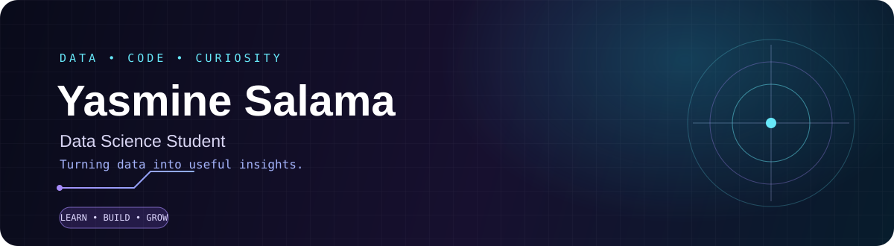

 

---

## `01 / A little about me`

Hi, I'm **Yasmine** — a Data Science student at **EST Kelaa des Sraghna, Morocco**.

I completed a DUT in **Data Engineering** and I'm now pursuing a Bachelor's degree in **Data Science**. I'm interested in the journey from raw data to meaningful insights: exploring datasets, building analytical solutions, and learning how machine learning can help solve real problems.

- 🎓 **Currently:** Bachelor's in Data Science
- 🔎 **Exploring:** Data analysis, machine learning, and data visualization
- 🧩 **My approach:** Learn the fundamentals, build projects, improve through practice

## `02 / My toolkit`

**Areas I'm building experience in:** data cleaning · exploratory data analysis · data visualization · data warehousing · machine learning · NLP

## `03 / Projects & practice`

<table>
<tr>
<td width="50%" valign="top">

### ◈ DevScope
**Developer profile analytics**

A project concept focused on collecting and analyzing developer-profile data, exploring technologies and activity, and presenting findings through a dashboard.

`Data collection` `Analytics` `Visualization`

</td>
<td width="50%" valign="top">

### ◈ Sentiment Analysis
**Text classification with machine learning**

An academic project exploring sentiment classification using text preprocessing, TF-IDF features, machine-learning models, and a Flask API.

`Python` `NLTK` `TF-IDF` `Flask`

</td>
</tr>
</table>

> Project links will be added when the repositories are published publicly.

## `04 / What I'm working toward`

- Strengthening my foundations in statistics, Python, and machine learning.
- Turning coursework into clear, well-documented projects.
- Growing as a data professional through consistent practice.

## `05 / Find me`

Want to connect or exchange ideas about data? Reach me on **[LinkedIn](https://www.linkedin.com/in/salama-yasmine)**.

<i>Curious by nature. Building one dataset at a time.</i>

